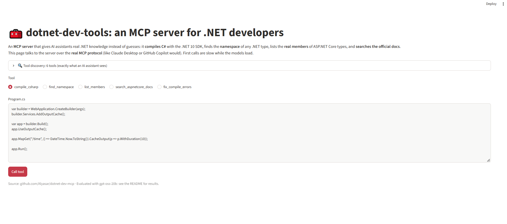
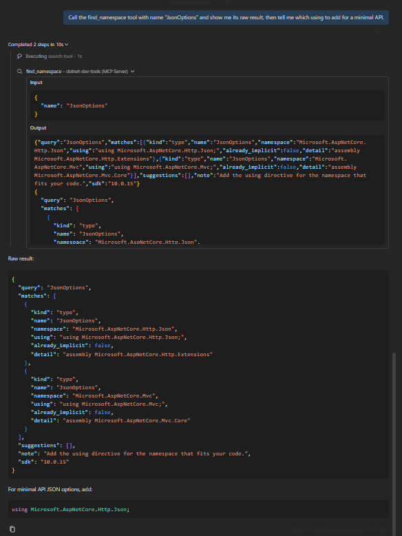
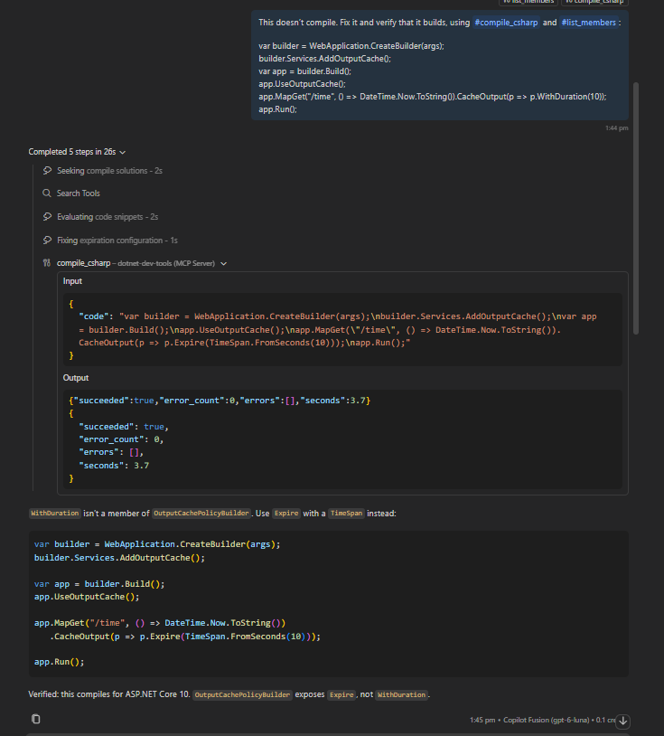
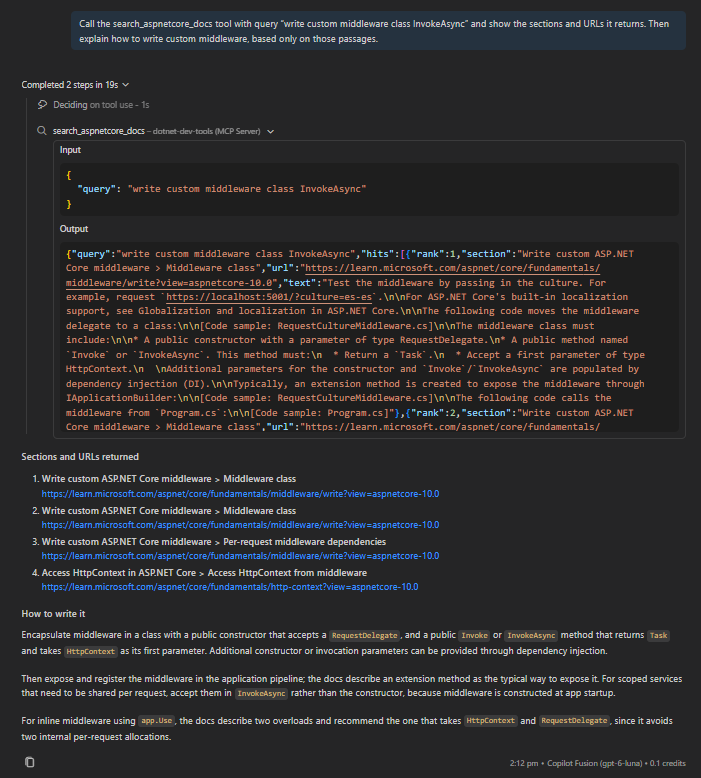
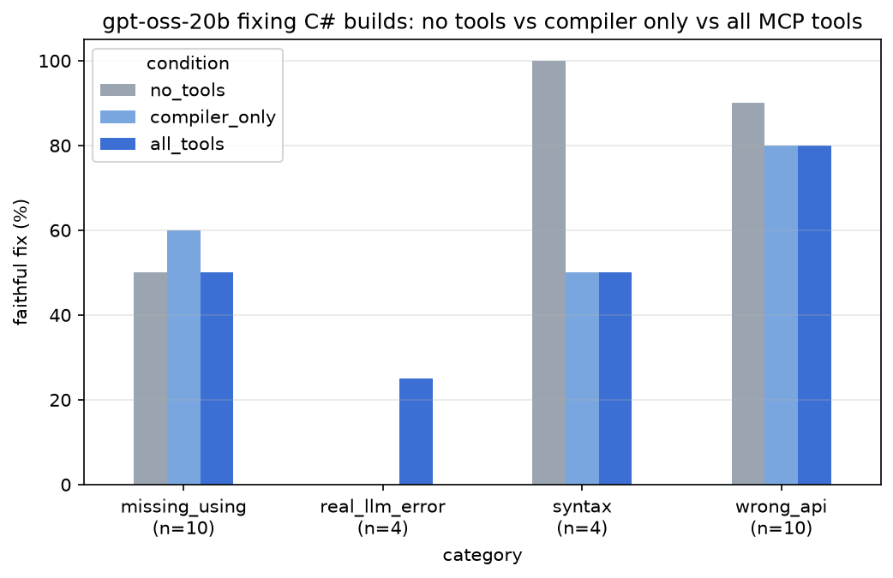

# 🧰 dotnet-dev-tools: an MCP server that gives AI assistants real .NET knowledge

A **Model Context Protocol (MCP) server** for .NET developers. Instead of guessing, an AI assistant can **compile C# with the real .NET 10 SDK**, look up **which namespace a type lives in**, list the **real members** of ASP.NET Core types, **search the official docs**, and try a **fine-tuned fixer model**, all as standard MCP tools that work in GitHub Copilot, Claude Desktop, Cursor or your own agent.

**🔗 Live playground:** [dotnet-dev-mcp.streamlit.app](https://dotnet-dev-mcp.streamlit.app/) (talks to the server over the real MCP protocol)



---

## Why

In my previous projects, LLMs failed at **knowledge**, not reasoning:
- a 120B multi-agent team ([Project 3](https://github.com/Alyasar/aspnetcore-coding-agents)) invented `policy.Expiration(...)` / `WithDuration(...)` for output caching and failed after 4 compile retries: the compiler says a name doesn't exist, but not what the right one is;
- a QLoRA fine-tuned model ([Project 4](https://github.com/Alyasar/csharp-fix-lora)) fixed 94% of synthetic errors but **0 / 4** real API-knowledge errors.

Both pointed to the same fix: **give the model tools that look things up**, rather than more training or more retries. MCP makes those tools reusable by any assistant.

## The tools

| Tool | What it does | Backed by |
|---|---|---|
| `compile_csharp` | Compiles a complete `Program.cs` (never runs it) and returns structured errors: line, CS code, message, offending source line | Real `dotnet build` (.NET 10) in a sandbox project |
| `find_namespace` | Which `using` a type or **extension method** needs; flags namespaces that are already implicit; "did you mean" for typos and invented names | An index of the **.NET 10 reference assemblies**: 6,711 types, 3,496 extension methods |
| `list_members` | The real public methods, properties and fields of an ASP.NET Core / Microsoft.Extensions type | Same index: 2,735 types with members |
| `search_aspnetcore_docs` | Best passages from the official ASP.NET Core 10 docs, with URLs | Hybrid search (bge-small + BM25 + RRF) and a cross-encoder reranker, from [Project 2](https://github.com/Alyasar/aspnetcore-rag-eval) |
| `fix_compile_errors` | A fine-tuned 1.5B model proposes a fix, then the tool **compiles it** and reports whether it builds | The QLoRA model from Project 4 (GGUF, llama.cpp on CPU) |
| `dotnet_info` | Installed .NET SDK versions | `dotnet --list-sdks` |

Every tool returns **structured output with a schema** (`TypedDict` → MCP output schema), and the tool docstrings are written for the model: `fix_compile_errors` states what it is *not* good at and points to `list_members` / `find_namespace` instead.

**The API index is built with C#.** [`indexer/Program.cs`](indexer/Program.cs) reads the installed reference assemblies with `System.Reflection.Metadata` (no loading, no execution) and writes [`data/api_index.json`](data/api_index.json): every public type → namespace, every extension method → namespace and class, and the member names of every ASP.NET Core type.

---

## It works in a real assistant

Connected to **GitHub Copilot** (agent mode) in VS Code:

| Knowledge lookup | Verify a fix with the compiler | Grounded docs answer |
|---|---|---|
|  |  |  |

**From memory vs. grounded:** asked the same middleware question *without* the tool, Copilot's answer set a response header **after** `await _next(context)`, a classic runtime bug ([screenshot](reports/demo_3_without_tool.png)). Grounded in `search_aspnetcore_docs`, it described the documented pattern instead.

---

## Evaluation: does an LLM fix builds better with these tools?

**Setup:** `gpt-oss-20b` (Groq) fixes **28 broken programs** in three conditions: same model, same prompt, temperature 0.
The agent ([`run_eval.py`](run_eval.py)) connects to the server **as an MCP client**, discovers the tools with `list_tools` and converts their schemas to function calling. Every final answer is **compiled by the evaluator itself**, independent of what the agent claims.

| Tasks | n | Source |
|---|---|---|
| Missing `using` | 10 | Project 4's held-out test set |
| Wrong API name | 10 | Project 4's held-out test set |
| Syntax (control) | 4 | Project 4's held-out test set |
| **Real LLM build failures** | 4 | Project 3 (where a 120B team failed) |

| | No tools | Compiler only | **All MCP tools** |
|---|---|---|---|
| **Compiles** | 79% | 79% | 79% |
| Faithful fix, strict rule\* | 68% | 64% | 68% |
| **Faithful fix, after manual review\*\*** | 71% (20/28) | 71% (20/28) | **75% (21/28)** |
| Real LLM errors fixed | 0 / 4 | 0 / 4 | **1 / 4** |
| Avg tool calls | 0 | 1.9 | 2.6 |
| Avg tokens per task | 2,844 | 5,946 | 8,043 |
| Avg seconds per task | 14 | 36 | 44 |

\* Compiles, no original line deleted, at most 2 lines changed (fixed before the run).
\*\* The strict rule counted removed comments and re-wrapped lines as changes; those 5 borderline answers were reviewed by hand, the same way for every condition (details in [`notebooks/02_results.ipynb`](notebooks/02_results.ipynb)).



### What the evaluation shows

1. **No measurable difference on this task set.** Identical compile rates (22/28 each) and faithful fixes within one task, at **2.8× the tokens and 3× the time** with all tools. With 28 tasks, one task is ~3.6 points: this is a null result, and it's reported as one.
2. **Why:** the model already knew most answers. Without tools it fixed **90% of the wrong-API** and **100% of the syntax** tasks: these synthetic mistakes are within a 20B model's own knowledge.
3. **Tools compete with reasoning for a tight budget.** Groq's free tier allows 8,000 tokens per request including the prompt. Tool schemas (~1K tokens) and tool results leave less room to think: in the all-tools condition, 3 of the 4 real tasks ended with the conversation **too large**. Under a tight budget, tools can hurt.
4. **Tool discipline was mixed.** Good: it compiled before answering in 27 of 28 tasks. Mixed: `find_namespace` was used in only 60% of missing-`using` tasks. Wasteful: 16 docs searches, often unneeded. Against the tool's own description: `fix_compile_errors` was called on API-name errors.
5. **The one clear win is exactly the designed case.** Only the all-tools condition fixed Project 3's real `Expiration` failure: `search_aspnetcore_docs` → `list_members` (found `Expire`) → `compile_csharp` → correct on the first answer. The same error defeated the 120B team with 4 retries.

**Takeaway:** tool access is not tool value. Tools pay off when the task needs knowledge the model lacks, when the context budget leaves room for them, and when the model uses them with discipline. A strong model (Copilot) mainly used the server to **verify**; a smaller one used it to **look up** the API it didn't know.

### Measurement notes (kept honest)
- Two scoring bugs were found **before** the full run by inspecting smoke-test failures (the code extractor missed some answer formats; a moved `using` line was counted as deleted) and fixed for all conditions.
- The output limit is set by one rule for every condition (whatever fits in the request limit), after a first attempt hit Groq's per-request limit.
- After the run, a token-based scoring rule was tried; it had its own artifacts (moved lines, multi-line strings), so it was dropped in favour of the strict rule plus a documented manual review rather than tuning the metric.

---

## Engineering notes

- **MCP Python SDK v2** (`MCPServer`, formerly `FastMCP`), stdio transport; the same tools can be served over Streamable HTTP.
- **stdout is the protocol.** Loading the models printed to stdout, so it was redirected to stderr, but a process-wide redirect started at import time raced with the SDK capturing stdout, and protocol messages went to stderr (the client timed out). Fix: start background loading from the server's **lifespan hook**, after the transport is set up.
- **Slow models load in the background** at startup; a lock makes the first call wait instead of loading twice.
- **One build at a time** (a lock around the shared sandbox), input guards on every tool, compile-only (generated code is never executed).
- **The fixer tool verifies itself:** compile → model fix → compile again; it never returns an unverified fix.
- The playground keeps **one MCP session alive** in a background event loop (`st.cache_resource`) so models load once for all visitors.

## Limitations

- 28 tasks, one run each; differences of 1–2 tasks are noise.
- The docs index covers Blazor, Fundamentals and MVC only, so the dedicated Rate limiting / Output caching articles (Performance section) are missing.
- `list_members` returns names, not signatures (it can't settle an overload question like `Results.Text(...)`'s parameters).
- The cloud playground runs without the 1 GB fixer model (memory); it's available when running locally.
- Single-file `Program.cs`, no NuGet packages.

## Next steps

1. Harder tasks built from real API-knowledge failures (like the 4 real cases), where tools should matter.
2. Re-run with a larger request budget or a stronger model; try a smaller tool set per task (e.g. no docs search for build errors).
3. Add the Performance and Security docs to the index; add method signatures to `list_members`.
4. Serve over Streamable HTTP with authentication for remote clients.

---

## Use it in your assistant

Needs Python 3.12 and the [.NET 10 SDK](https://dotnet.microsoft.com/download).

```powershell
git clone https://github.com/Alyasar/dotnet-dev-mcp.git
cd dotnet-dev-mcp
py -3.12 -m venv .venv
.\.venv\Scripts\Activate.ps1
python -m pip install -r requirements.txt
python -m pip install llama-cpp-python --extra-index-url https://abetlen.github.io/llama-cpp-python/whl/cpu   # optional: the fixer tool
dotnet run --project indexer -- "$PWD\data\api_index.json"   # optional: rebuild the API index for your SDK
```

**VS Code (GitHub Copilot, agent mode):** `.vscode/mcp.json`
```json
{
  "servers": {
    "dotnet-dev-tools": {
      "type": "stdio",
      "command": "C:\\path\\to\\dotnet-dev-mcp\\.venv\\Scripts\\python.exe",
      "args": ["C:\\path\\to\\dotnet-dev-mcp\\server.py"]
    }
  }
}
```

**Claude Desktop:** Settings → Developer → Edit Config
```json
{
  "mcpServers": {
    "dotnet-dev-tools": {
      "command": "C:\\path\\to\\dotnet-dev-mcp\\.venv\\Scripts\\python.exe",
      "args": ["C:\\path\\to\\dotnet-dev-mcp\\server.py"]
    }
  }
}
```

**Test it with the MCP Inspector:** `npx @modelcontextprotocol/inspector .venv\Scripts\python.exe server.py`
**Run the evaluation** (needs `GROQ_API_KEY`): `python run_eval.py --condition all_tools`

## Project structure

```
dotnet-dev-mcp/
├── server.py            # The MCP server: 6 tools, structured outputs, background model loading
├── api_index.py         # find_namespace / list_members lookups
├── indexer/Program.cs   # C#: builds data/api_index.json from the .NET 10 reference assemblies
├── csharp.py            # dotnet build sandbox + compiler-error parser (from Project 4)
├── rag.py               # Hybrid docs search + reranker (from Project 2)
├── app.py               # Streamlit playground (an MCP client)
├── dotnet_setup.py      # Installs the .NET SDK on Linux hosts (Streamlit Cloud)
├── run_eval.py          # Evaluation agent: MCP client + Groq function calling
├── check_failures.py    # Diff of every failed answer vs. the original
├── test_client.py       # Minimal MCP client used for testing
├── notebooks/           # 01_eval_set, 02_results
├── evals/               # tasks.jsonl and results per condition
└── reports/             # Charts, summary.csv, screenshots
```

## Tech stack

Python · MCP Python SDK v2 · C# / .NET 10 (System.Reflection.Metadata) · Groq (gpt-oss-20b) · ChromaDB · sentence-transformers · BM25 · llama.cpp (GGUF) · Streamlit · GitHub Copilot (agent mode) · MCP Inspector
